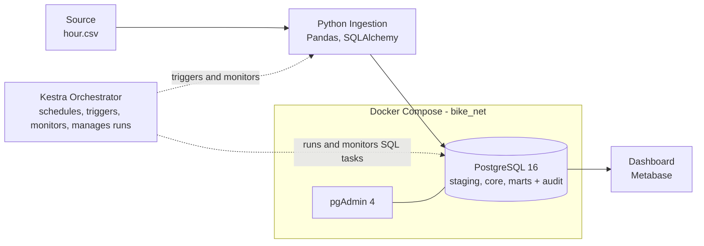

# Architecture

Data flow: `hour.csv` (UCI) -> Python Ingestion -> PostgreSQL (staging -> core -> marts) -> Metabase Dashboard.
Kestra is the orchestration and control layer across the pipeline: it schedules, triggers, monitors and manages
pipeline execution, and coordinates the Python ingestion and SQL tasks. Data does not flow through Kestra.

Phase 1 environment: PostgreSQL 16 and pgAdmin 4 only. Python ingestion, Kestra and Metabase are planned for later phases.

| Layer | Schema | Content |
|---|---|---|
| Raw copy | `staging` | `stg_bike_hourly`, the 17 source columns plus `loaded_at` |
| Star schema | `core` | `dim_date`, `dim_weather`, `fact_rentals` |
| Reporting | `marts` | `vw_hourly_demand` (Q1), `vw_weather_impact` (Q2), `vw_monthly_growth` and `vw_seasonal_demand` (Q3) |
| Quality | `audit` | `rejected_records` |

Validation rules applied during ingestion: schema and types, unique `instant`, value domains
(`season` 1-4, `hr` 0-23, `weathersit` 1-4, ...), binary flags, normalized weather values between 0 and 1,
non-negative counts, `cnt = casual + registered`, and a parseable `dteday`.
